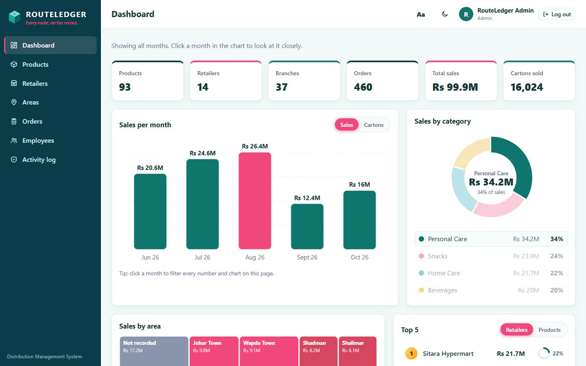
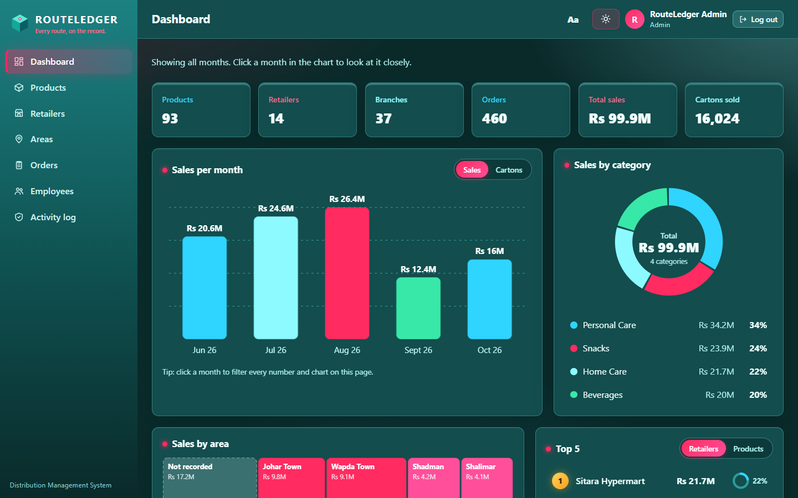
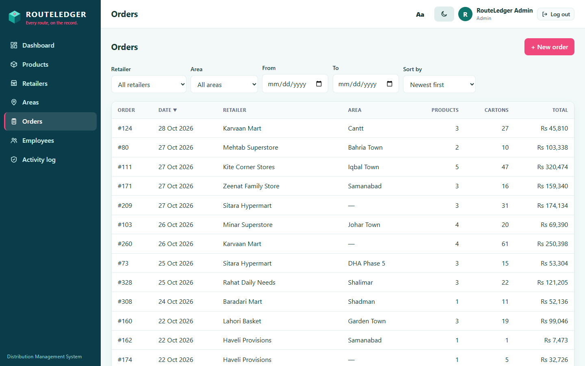
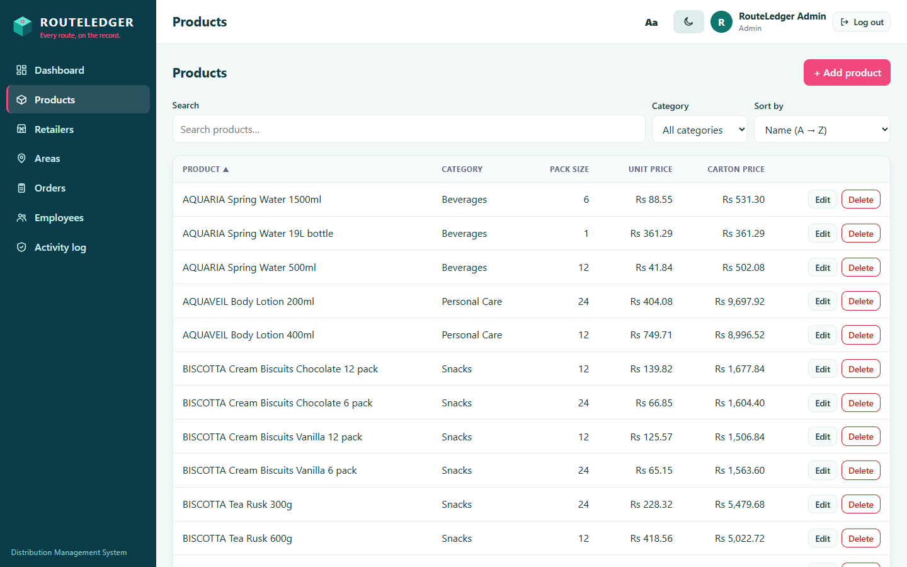
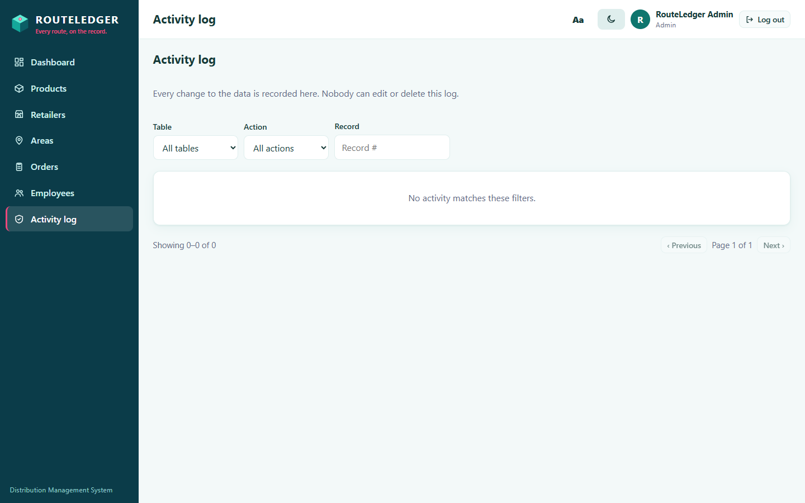
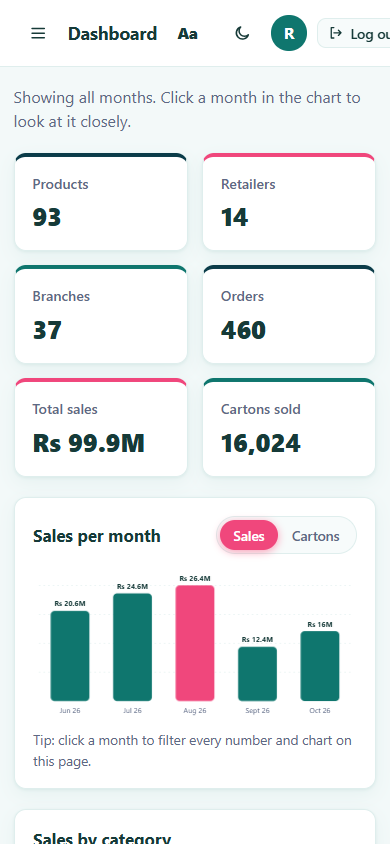
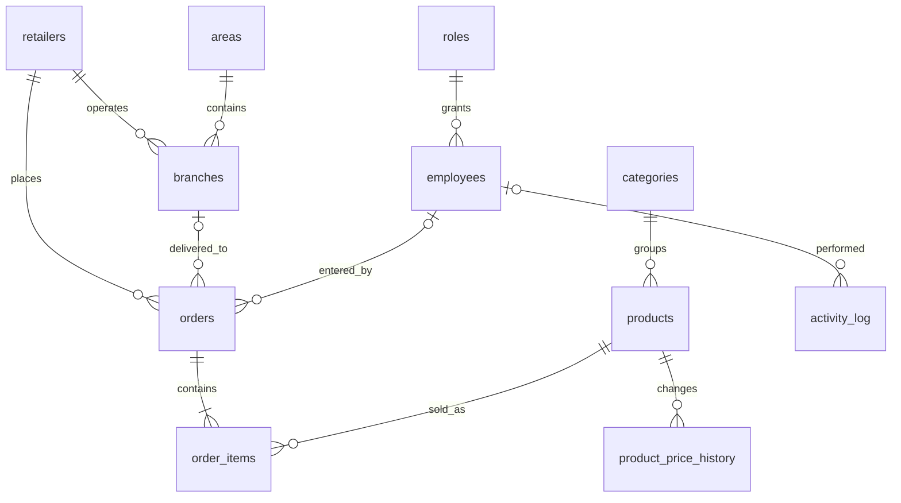

# RouteLedger

**A role-based distribution management system that replaces spreadsheet workflows with one
auditable source of truth.**

[](https://github.com/hooria-adeel/routeledger/actions/workflows/ci.yml)
[](#testing)
[](https://www.python.org/)
[](https://www.postgresql.org/)
[](LICENSE)
[](Dockerfile)

[](https://render.com/deploy?repo=https://github.com/hooria-adeel/routeledger)

**Live demo:** <https://routeledger-omega.vercel.app> — sign in with the
read-only account `demo@routeledger.example` / `DemoViewer!2026`. It can browse
every list and the dashboard but cannot change data. The Administrator password
is not published; set your own when you deploy.

RouteLedger is a full-stack demo of the system a distributor needs when product lists, retailer
lists and orders live in emailed Excel files. Employees log in, search one shared database, and
only authorised roles can change data. Every change is written to an append-only audit log by the
database itself, concurrent edits cannot silently overwrite each other, and deleted records can be
restored.

> **All data is synthetic.** Brands, products, retailers, areas and orders are generated by
> [`database/generate_seed.py`](database/generate_seed.py) with a fixed random seed. No real
> company or customer data is included.



## Highlights

| | |
|---|---|
| **Database-first design** | 11 tables in 3NF, 7 reporting views, 16 triggers, 11 indexes, optimistic locking, soft delete |
| **Audited by PostgreSQL** | insert/update/delete on seven tables logged with before/after JSON and the acting employee |
| **Four real roles** | Viewer, Editor, Manager, Admin — enforced on the server, not by hiding buttons |
| **Hardened login** | Argon2id, signed HttpOnly cookie, account lockout, rate limiting, CSRF origin check |
| **Fast search** | server-side search with GIN trigram indexes, paging capped at 100 rows |
| **Dashboard** | KPI cards, monthly sales, category donut, area treemap, top retailers/products, month filter |
| **Accessible UI** | light/dark theme, three text sizes, keyboard focus, responsive layout |
| **75 security + 18 database tests** | constraints, triggers, views, rollback, RBAC and attack payloads |

## Screenshots

| Dashboard (light) | Dashboard (dark) |
|---|---|
|  |  |

| Orders | Products |
|---|---|
|  |  |

| Activity log | Mobile |
|---|---|
|  |  |

## Quick start

### Docker (one command)

```bash
export SECRET_KEY="$(python -c 'import secrets; print(secrets.token_urlsafe(48))')"
export ADMIN_PASSWORD="choose-a-strong-admin-password"
docker compose up --build
```

Open <http://localhost:8000> and log in as `admin@routeledger.example` with the
`ADMIN_PASSWORD` you just chose. The repo does not ship a default password.

The container waits for PostgreSQL, loads the schema and synthetic data on first boot, creates the
limited application role, and creates the admin account. For a real deployment, override
`SECRET_KEY`, `APP_DB_PASSWORD`, `POSTGRES_PASSWORD`, `ADMIN_PASSWORD` and set
`COOKIE_SECURE=true` — see [docs/deployment.md](docs/deployment.md).

### Manual installation

```bash
createdb routeledger && createdb routeledger_test

psql -d routeledger      -f database/schema.sql -f database/seed.sql -f database/seed_demo_orders.sql
psql -d routeledger_test -f database/schema.sql -f database/seed.sql

# edit database/create_app_user.sql (choose a strong password), then:
psql -d routeledger      -f database/create_app_user.sql
psql -d routeledger_test -f database/create_app_user.sql

cd backend
python -m venv .venv && . .venv/bin/activate      # Windows: .venv\Scripts\activate
pip install -r requirements-dev.txt
cp .env.example .env                              # set DB_PASSWORD and SECRET_KEY
python -m scripts.create_admin
uvicorn app.main:app --reload
```

## Database design



What makes the database the interesting part of this project:

- **Integrity in the schema** — foreign keys everywhere, `UNIQUE` product/retailer/area names,
  branch names unique within a retailer, `CHECK` rules for prices and cartons, one product per
  order line.
- **Optimistic locking in a trigger** — every business row has `version`. A stale save raises
  `40001`, which the API turns into `409 Conflict` with a clear message.
- **Audit and price history** — triggers, not application code, write `activity_log` and
  `product_price_history`. The log is append-only.
- **Reporting views** — seven views (`v_sales_detail`, `v_sales_by_month`, `v_sales_by_area`, …)
  power the dashboard without duplicating SQL.
- **Least privilege** — the web app connects as `routeledger_app`, which cannot drop tables,
  alter roles, or update/delete the audit log.
- **Soft delete** — records are hidden, not destroyed, and Managers can restore them.

The full ER diagram, data dictionary, normalisation notes and trigger catalogue are in
[docs/database.md](docs/database.md). Analytical queries and report SQL live in
[docs/queries.sql](docs/queries.sql).

## Security

| Control | Implementation |
|---|---|
| Password storage | Argon2id; policy of 10+ characters with upper, lower and digit |
| Sessions | signed JWT in an `HttpOnly`, `SameSite=Lax` cookie; `Secure` + HSTS in production |
| Brute force | 5 failures → 15-minute lock; 10 login attempts/minute/IP |
| Authorisation | server-side permission dependency on every write |
| SQL injection | bound parameters only; sort columns from an allow-list |
| CSRF | foreign `Origin` / `Sec-Fetch-Site: cross-site` rejected |
| XSS | DOM-built pages, no inline scripts, strict CSP |
| Host attacks | `TrustedHostMiddleware` allow-list |
| Audit | append-only log written by triggers |
| Secrets | environment variables, `.env` git-ignored |

Details, STRIDE analysis and OWASP Top 10 mapping: [docs/security.md](docs/security.md).

## Tech stack

**Backend:** Python, FastAPI, psycopg 3 (connection pool), Pydantic v2, Argon2id, PyJWT
**Database:** PostgreSQL 16+ (triggers, views, GIN trigram indexes, least-privilege role)
**Frontend:** vanilla JavaScript and CSS, no build step, custom SVG charts
**Ops:** Docker, Docker Compose, Vercel + Neon (live demo), Render blueprint, GitHub Actions, pytest

## Testing

```bash
cd backend
pytest -q
```

**93 tests** run against a real PostgreSQL database (`routeledger_test`):

- **Security (75):** password hashing, lockout, rate limiting, forged/expired tokens, SQL injection
  payloads, RBAC for every role, stale edits, transaction rollback, audit immutability, headers,
  CSP, origin checks, least-privilege database role.
- **Database (18):** views and triggers exist, constraints reject bad data, version conflicts,
  audit and price-history rows, append-only log, report reconciliation, soft delete, rollback.

CI runs the suite on Python 3.12 and 3.13 against a PostgreSQL service container, and builds the
Docker image on every push.

## Project structure

```
routeledger/
├─ backend/        FastAPI app, scripts, tests
├─ database/       schema.sql, seed data, grants, synthetic data generator
├─ docs/           architecture, database, security, deployment, screenshots
├─ frontend/       static HTML/CSS/JS
├─ docker/         container entrypoint
├─ index.py        Vercel serverless entrypoint
├─ vercel.json     Vercel function configuration
├─ Dockerfile
├─ docker-compose.yml
├─ render.yaml
└─ .github/        CI and Dependabot
```

## Scope

**In scope:** products, retailers, branches, areas, multi-line orders, dashboard, audit log,
employee administration, roles, search/sort/filter/paging, soft delete and restore.

**Out of scope (by design):** stock quantities, invoicing, payments, delivery tracking, customer
portal, mobile app, self-service password reset by email. These keep the project focused on the
database and access-control story.

## Roadmap

- [ ] Row-level security demo for multi-tenant use
- [ ] Materialised dashboard view with scheduled refresh
- [ ] Backup/restore drill script and documented recovery time
- [ ] Query benchmark page (`EXPLAIN ANALYZE` before/after indexes)

## License

[MIT](LICENSE) © 2026 Hooria Adeel
