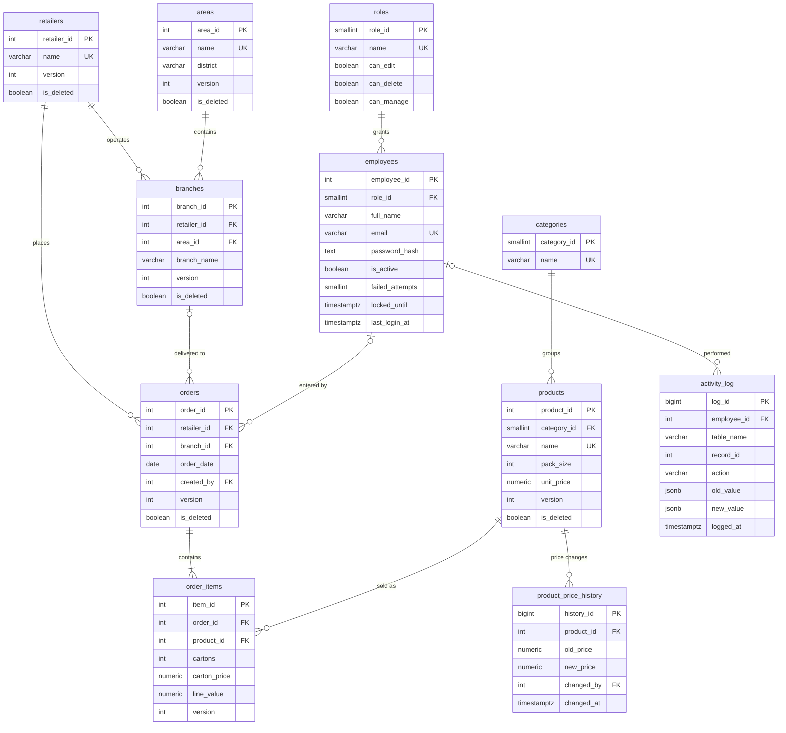

# Database design

RouteLedger runs on PostgreSQL 16+ and is designed so the database protects the
data even if the application has a bug. The full definition is in
[`database/schema.sql`](../database/schema.sql); this page explains the *why*.

Related: requirements in [`srs.md`](srs.md), design rationale in
[`sds.md`](sds.md), the standalone diagram in [`erd.md`](erd.md), and data
movement in [`dfd.md`](dfd.md).

## Entity-relationship diagram

The standalone diagram, cardinality rationale and normalisation notes are in
[`erd.md`](erd.md). The short version:



## Data dictionary

Every business table also has `created_at` and `updated_at` (not repeated below).

| Table | Column | Type | Rules |
|---|---|---|---|
| `roles` | `role_id` | smallserial | primary key |
| | `name` | varchar(20) | unique |
| | `can_edit`, `can_delete`, `can_manage` | boolean | permission flags used by the API |
| `employees` | `employee_id` | serial | primary key |
| | `role_id` | smallint | foreign key → `roles` |
| | `full_name` | varchar(100) | required |
| | `email` | varchar(150) | unique, email format check |
| | `password_hash` | text | Argon2id only |
| | `is_active` | boolean | deactivated users lose access immediately |
| | `failed_attempts` | smallint | ≥ 0, drives the lockout |
| | `locked_until` | timestamptz | null when not locked |
| | `last_login_at` | timestamptz | updated on successful login |
| `categories` | `category_id`, `name` | smallserial, varchar(50) | name unique |
| `products` | `product_id` | serial | primary key |
| | `category_id` | smallint | foreign key → `categories` |
| | `name` | varchar(150) | unique |
| | `pack_size` | integer | > 0 (units per carton) |
| | `unit_price` | numeric(12,2) | ≥ 0 |
| | `version`, `is_deleted` | integer, boolean | optimistic lock, soft delete |
| `product_price_history` | `history_id` | bigserial | primary key |
| | `product_id` | integer | foreign key → `products` |
| | `old_price`, `new_price` | numeric(12,2) | captured by trigger |
| | `changed_by` | integer | foreign key → `employees` |
| `areas` | `area_id`, `name`, `district` | serial, varchar(80) | name unique; district optional |
| `retailers` | `retailer_id`, `name` | serial, varchar(120) | name unique |
| `branches` | `branch_id` | serial | primary key |
| | `retailer_id` | integer | foreign key → `retailers` |
| | `area_id` | integer | foreign key → `areas` |
| | `branch_name` | varchar(80) | unique **within** a retailer |
| `orders` | `order_id` | serial | primary key |
| | `retailer_id` | integer | required foreign key |
| | `branch_id` | integer | optional foreign key; must belong to the retailer |
| | `order_date` | date | not before 2000-01-01; server also rejects future dates |
| | `created_by` | integer | employee who entered it (null for imports) |
| `order_items` | `item_id` | serial | primary key |
| | `order_id` | integer | foreign key, cascade delete |
| | `product_id` | integer | foreign key → `products` |
| | `cartons` | integer | > 0 |
| | `carton_price` | numeric(14,2) | ≥ 0; price **at the time of sale** |
| | `line_value` | numeric(16,2) | ≥ 0; `cartons × carton_price` |
| | — | — | one product per order (`UNIQUE (order_id, product_id)`) |
| `activity_log` | `log_id` | bigserial | primary key |
| | `employee_id` | integer | who did it (nullable for imported rows) |
| | `table_name`, `record_id` | varchar(50), integer | what changed |
| | `action` | varchar(10) | `INSERT`, `UPDATE` or `DELETE` |
| | `old_value`, `new_value` | jsonb | complete row snapshots |
| | `logged_at` | timestamptz | when |

## Normalisation

The source was one flat Excel sheet. It was decomposed to third normal form:

1. **1NF** — one value per cell. Order lines (repeating product columns) became
   rows in `order_items`; a multiline order became one `orders` row plus many
   `order_items` rows.
2. **2NF** — no partial dependencies. A product's name, pack size and price
   depend only on `product_id`, so they live in `products`, not in every order
   line. The only order-line attribute that legitimately varies per sale is the
   actual `carton_price`, which is stored on the line.
3. **3NF** — no transitive dependencies. A branch's area is stored once in
   `branches.area_id`; the area name lives in `areas`. A retailer's name is not
   repeated on each order.

Deliberate denormalisation: `order_items.line_value` duplicates
`cartons × carton_price`. It is stored so a later price change can never alter a
historical invoice, and it is protected by a `CHECK` plus server-side
calculation.

## Integrity rules enforced by PostgreSQL

| Rule | Mechanism |
|---|---|
| Every relationship points to a real row | foreign keys on every link |
| No duplicate product, retailer, area or branch-within-retailer | `UNIQUE` constraints |
| Prices and cartons are sane | `CHECK` constraints |
| One product appears once per order | `UNIQUE (order_id, product_id)` |
| An order is saved with all its lines or not at all | transaction in the API |
| Concurrent edits never overwrite each other | version trigger (`fn_touch_row`) |
| Every change is auditable | audit triggers on 7 tables |
| The audit log cannot be rewritten | `trg_log_readonly` + no `UPDATE`/`DELETE` grant |
| Price changes keep a history | `fn_price_history` trigger |

## Triggers

| Trigger | Tables | Purpose |
|---|---|---|
| `trg_touch_*` (7) | categories, products, areas, retailers, branches, orders, order_items | reject stale versions, increment `version`, set `updated_at` |
| `trg_audit_*` (7) | same business tables | write before/after JSON into `activity_log` |
| `trg_price_history` | products | record old/new unit price and the employee |
| `trg_log_readonly` | activity_log | refuse `UPDATE` and `DELETE` |

## Views

| View | Use |
|---|---|
| `v_product_list` | product list with category and carton price |
| `v_branch_list` | branches with retailer and area names |
| `v_sales_detail` | one row per order line, the base for reports |
| `v_sales_by_retailer` | sales per retailer |
| `v_sales_by_product` | best-selling products |
| `v_sales_by_month` | monthly sales trend (the dashboard adds live order counts) |
| `v_sales_by_area` | geographic mix (unknown area becomes "Not recorded") |

## Indexes

- **GIN trigram** on `products.name` and `retailers.name` — keeps `ILIKE '%text%'`
  searches fast as the catalogue grows.
- Foreign-key columns (`category_id`, `retailer_id`, `area_id`, `order_id`,
  `product_id`) and `orders.order_date` — joins, filters and date ranges.
- `activity_log (table_name, record_id)` and `logged_at` — log filtering.

## Concurrency and soft delete

`version` starts at 1. The API sends the version the user saw. The trigger
compares it with the stored value:

```sql
IF NEW.version <> OLD.version THEN
    RAISE EXCEPTION 'Stale edit ...' USING ERRCODE = '40001';
END IF;
```

A conflict becomes HTTP `409 Conflict`. Deletes set `is_deleted = TRUE`; every
read filters it out, and Manager/Admin can restore. Historical orders and the
audit log are never destroyed by normal use.

## Reproducing the data

`database/generate_seed.py` creates the synthetic catalogue and orders with a
fixed random seed, so `seed.sql` and `seed_demo_orders.sql` are reproducible and
contain no real company data.
