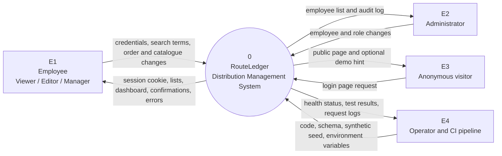
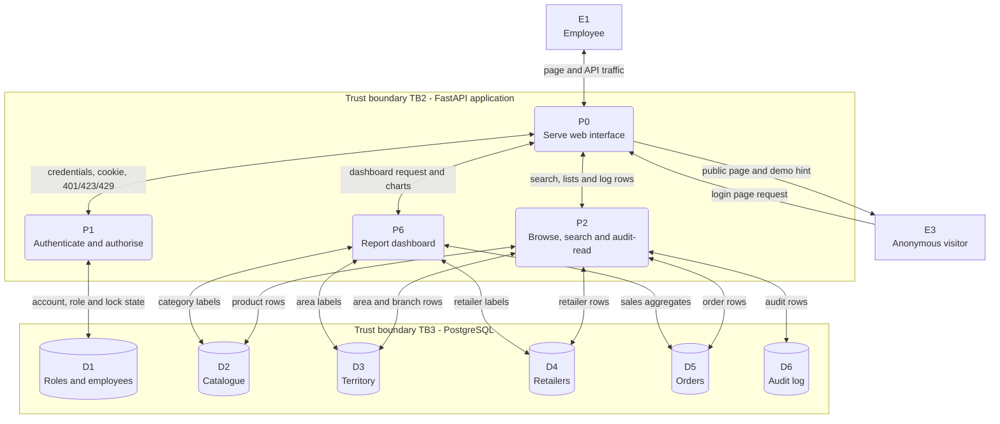
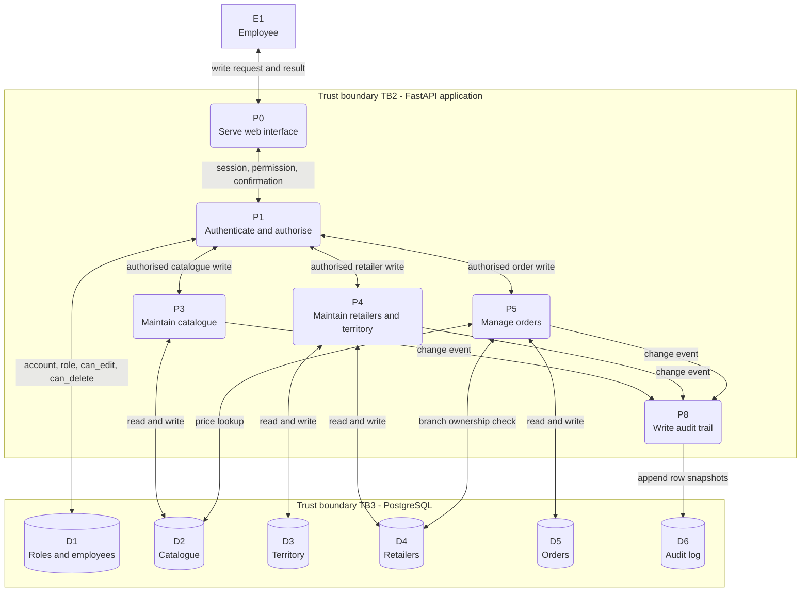
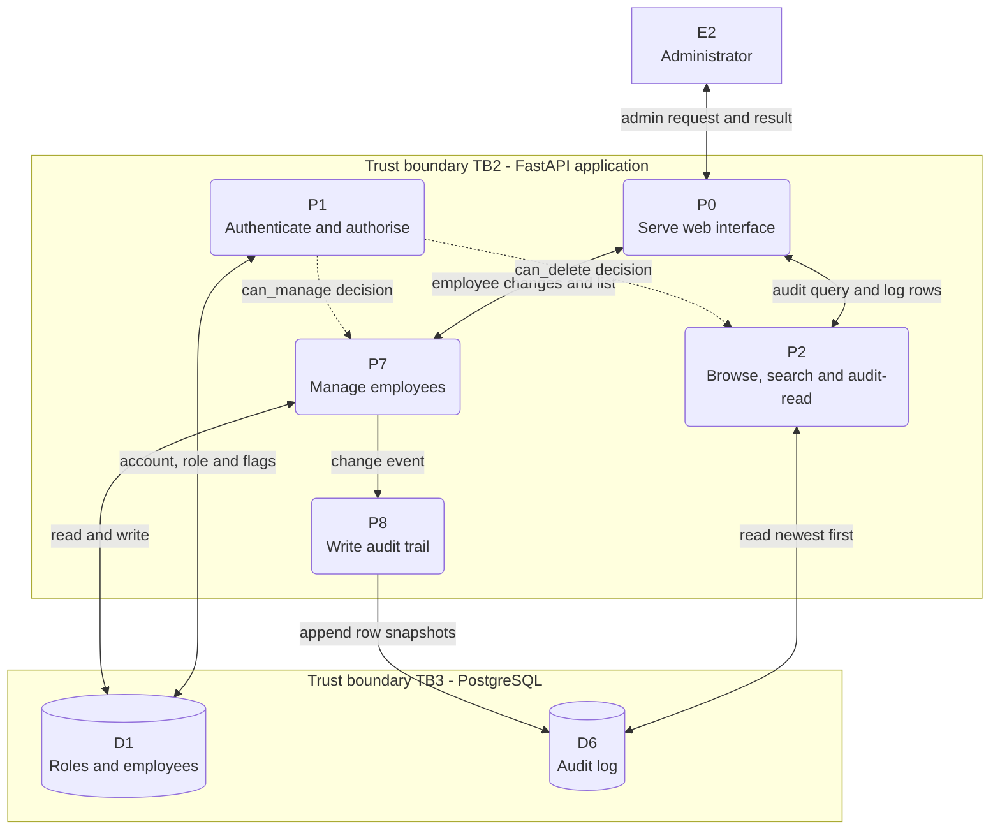
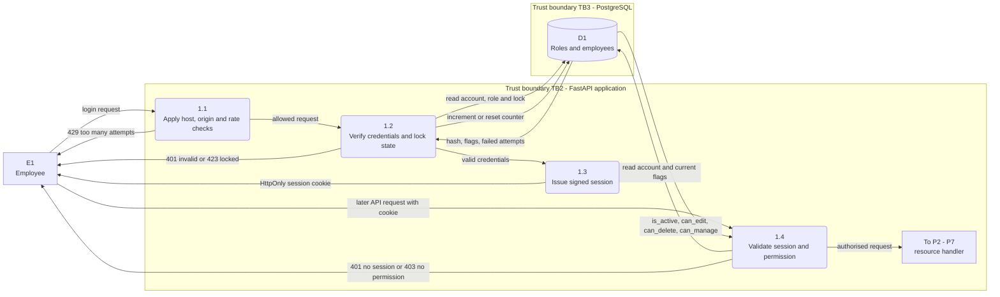
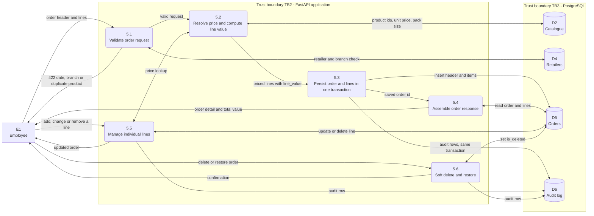
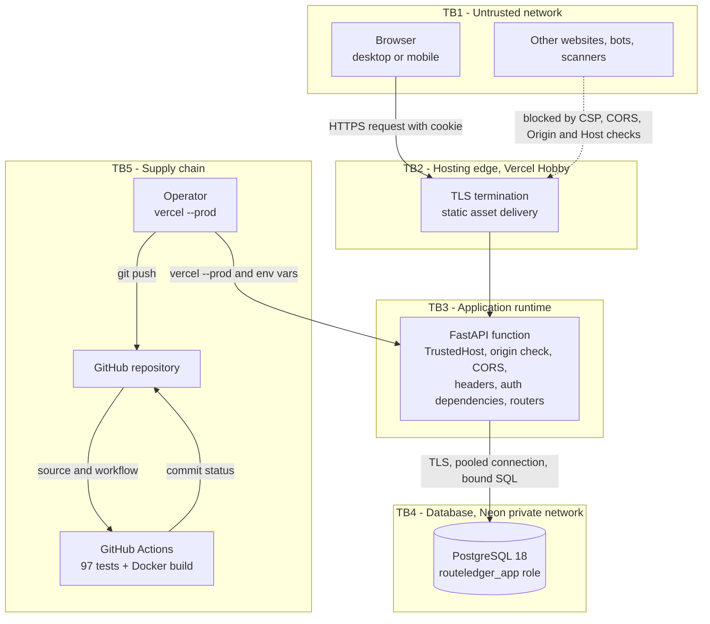

# Data Flow Diagram (DFD)

**Project:** RouteLedger — Distribution Management System
**Companion documents:** [SRS](srs.md) · [SDS](sds.md) · [ERD](erd.md) · [Architecture](architecture.md) · [Security](security.md)

This page shows how data moves through RouteLedger: the external entities, the
processes, the six logical data stores, and the trust boundaries it crosses. It
uses the standard decomposition — context, level 1 (shown as three paths for
legibility), and level 2 for authentication and order management.

> All data is synthetic. No real customer, employee or order data exists in the
> repository or the public demo.

---

## 1. Notation

| Symbol in the diagrams | DFD meaning |
|---|---|
| Rectangle, `E1` … `E4` | External entity (a person, role or system outside the boundary) |
| Rounded box, `P0` … `P8`, `5.1` … | Process (transforms input into output) |
| Cylinder, `D1` … `D6` | Data store (persistent data; one store may cover several tables) |
| Solid labelled arrow | Data flow, with the payload written on the arrow |
| Dotted arrow | Control flow (an authorisation decision), not data |
| Tinted subgraph | Trust boundary (data crossing it is untrusted until validated) |

Mermaid has no native DFD shapes, so cylinders represent the logical stores and
rounded boxes represent processes. The numbering is stable across the diagrams:
`P1` in level 1 expands to `1.1`, `1.2`, … in level 2.

## 2. Level 0 — context diagram

RouteLedger is one process. Everything outside it is an external entity.

### External entities

| ID | Entity | Interest | Trust level |
|---|---|---|---|
| E1 | Employee (Viewer, Editor, Manager) | Read data; Editors and Managers also change it | Authenticated, untrusted input |
| E2 | Administrator | Manage employees and roles, read the audit log | Authenticated, highest privilege |
| E3 | Anonymous visitor | Load the login page, optionally use the read-only demo account | Unauthenticated |
| E4 | Operator / CI pipeline | Deploy code, apply schema, read health and test results | Trusted, outside the request path |

**Why the operator is an external entity:** schema and seed files enter the
system through a deliberate deployment step, not through the running
application. The application role cannot perform DDL, so this flow is physically
separated from E1–E3.

## 3. Level 1 — major processes and data stores

Level 1 is drawn as three paths that share the same process numbers. Read and
report traffic is separated from writes, and administration is separated from
both, because each path touches a different subset of stores. Together they form
the complete level 1.

### 3.1 Read and report path

### 3.2 Write path

### 3.3 Administration and audit path

### Processes

| ID | Process | Inputs | Outputs | Requirement source |
|---|---|---|---|---|
| P0 | Serve web interface | Page and asset requests | HTML, CSS, JS, 404 | NFR-M2, NFR-U1 |
| P1 | Authenticate and authorise | Credentials, session cookie | Cookie, employee, `401`/`403`/`423`/`429` | FR-A1 … FR-A10 |
| P2 | Browse, search and audit-read | Search, filters, paging, log filters | Lists, detail, log rows | FR-P1, FR-R1, FR-O9, FR-L2 |
| P3 | Maintain catalogue | Product and category changes with `version` | Saved row or `409`/`422` | FR-P2 … FR-P6 |
| P4 | Maintain retailers and territory | Retailer, branch and area changes | Saved row or `409`/`422` | FR-R1 … FR-R5 |
| P5 | Manage orders | Order header, lines, deletions | Order detail, total, `409`/`422` | FR-O1 … FR-O9 |
| P6 | Report dashboard | Optional month filter | Totals, trends, rankings | FR-D1 … FR-D4 |
| P7 | Manage employees | Employee, role, password, status | Employee list, confirmation | FR-E1 … FR-E5 |
| P8 | Write audit trail | Change events from P3, P4, P5 and P7 | Append-only log rows | FR-L1 … FR-L4 |

### Data stores

| ID | Logical store | Physical tables | Written by | Read by |
|---|---|---|---|---|
| D1 | Roles and employees | `roles`, `employees` | P7 (seed/bootstrap for initial rows) | P1, P2, P7 |
| D2 | Catalogue | `categories`, `products`, `product_price_history` | P3, price trigger | P2, P3, P5, P6 |
| D3 | Territory | `areas`, `branches` | P4 | P2, P4, P6 |
| D4 | Retailers | `retailers` (+ branch ownership) | P4 | P2, P4, P5, P6 |
| D5 | Orders | `orders`, `order_items` | P5 | P2, P5, P6 |
| D6 | Audit log | `activity_log` | P8 (trigger) | P2 (Manager/Admin only) |

D2 and D3 are split from D4 because they have different owners and different
change rates. The reporting views cross all five business stores, which is why
P6 reads from several of them in one request.

## 4. Level 2 — authentication (P1)

| Sub-process | Rule | Failure |
|---|---|---|
| 1.1 | 10 login attempts per minute per IP; reject foreign `Origin`/`Sec-Fetch-Site`; reject unknown `Host` | `429`, `403`, `400` |
| 1.2 | Case-insensitive email lookup, Argon2id verify, `is_active`, `locked_until`, 5-failure lock | `401`, `423` |
| 1.3 | HS256 JWT with `sub`, `iat`, `exp`; cookie `HttpOnly`, `SameSite=Lax`, `Secure` in production | — |
| 1.4 | Signature and expiry, then **reload** employee and role from D1 on every request | `401`, `403` |

Step 1.4 is deliberate: a role change or deactivation takes effect on the next
request instead of waiting for the token to expire.

## 5. Level 2 — order management (P5)

### Transaction behaviour

`5.3` is the only place that creates an order. The header and every line share
one database transaction:

- If any line violates a constraint, the whole transaction rolls back and no
  order exists.
- The audit triggers in D6 fire inside that transaction, so a rolled-back order
  leaves no audit row either.
- `5.5` refuses to delete the last remaining line (`400`), because an order with
  no lines has no value.
- `5.4` reads back the saved rows rather than trusting the request, so the
  response shows the stored `line_value`.

## 6. Data flow catalogue

| # | From → To | Payload | Validation applied |
|---|---|---|---|
| F1 | E1 → P1 | Email, password | Length limits, rate limit, origin check |
| F2 | P1 → E1 | Session cookie / `401` / `423` / `429` | Signed JWT, generic error text |
| F3 | P1 ↔ D1 | Account, role flags, lock counters | Bound SQL; counters committed before error |
| F4 | E1 → P2 | Search text, filters, page, sort key | Length caps, `Literal` sort, `page_size ≤ 100` |
| F5 | P2 → E1 | Paged rows, detail, audit rows | Role check for D6 |
| F6 | P2 ↔ D2–D6 | Read queries | Bound parameters, views filter soft-deleted rows |
| F7 | E1 → P3 | Product/category writes + `version` | Pydantic ranges, unique/check constraints, stale check |
| F8 | E1 → P4 | Retailer/branch/area writes + `version` | Unique branch within retailer, FK checks |
| F9 | E1 → P5 | Order header, lines, `version` | Date, branch ownership, duplicate product, cartons > 0 |
| F10 | P5 → E1 | Order detail, total, `409`/`422` | Recomputed totals |
| F11 | P5 ↔ D2, D4, D5 | Prices, retailer/branch, order rows | FK and check constraints |
| F12 | P5 → D6 | Before/after row snapshots | Trigger writes actor from `app.current_employee_id` |
| F13 | E1 → P6 | Month filter | Optional date value |
| F14 | P6 → E1 | Totals, monthly, category, area, top lists | Reads only views |
| F15 | E2 → P7 | Employee create/update, role, password, active flag | Password policy, role lookup, `can_manage` |
| F16 | E2 → P2 | Audit filters (table, record, employee, action) | `can_delete` (= Manager/Admin), action pattern |
| F17 | E4 → P0 | Code, schema, seed, environment variables | Out-of-band deployment, not an API |
| F18 | P0 → E4 | `/health`, test status, platform logs | Product count only |

## 7. Trust boundaries

| Boundary | What crosses it | Controls on the crossing |
|---|---|---|
| TB1 → TB2 | HTTP requests, cookies, form data | HTTPS only; `Secure` cookie; HSTS when enabled |
| TB1 → TB3 (logical) | All user input | `TrustedHostMiddleware`, origin check, CORS, Pydantic validation, bound SQL, output encoding |
| TB2 → TB3 | Proxied request with platform headers | Platform URL added to allow-lists automatically; application re-checks origin |
| TB3 → TB4 | SQL and connection credentials | TLS to Neon, least-privilege role, no DDL, no audit rewrite, parameterised statements |
| TB4 → TB3 | Query results | Row-level `dict_row`; no dynamic SQL identifiers from user input |
| TB5 → TB3 | New code and configuration | Reviewed commits, CI tests, manual production deploy, secrets set in the platform |
| TB5 → TB1 | Published demo credentials | Read-only Viewer only; `GET /auth/demo` is env-gated |

### Threat notes at the boundaries

| Threat | Boundary | Mitigation |
|---|---|---|
| Credential stuffing | TB1 → TB3 | 10/minute rate limit, 5-failure lockout, uniform error message |
| Session theft via JavaScript | Browser | `HttpOnly` cookie; no token in `localStorage` |
| CSRF | TB1 → TB3 | `SameSite=Lax` plus explicit `Origin` / `Sec-Fetch-Site` rejection |
| SQL injection | TB3 → TB4 | Bound parameters; sort columns from a fixed map |
| Stored XSS | TB3 → TB1 | DOM-built pages, strict CSP, JSON content type |
| DNS rebinding | TB1 → TB2 | `TrustedHostMiddleware` allow-list |
| Privilege escalation | TB3 | `require()` re-reads flags per request; DB role cannot alter grants |
| Audit tampering | TB3 → TB4 | Append-only trigger plus revoked `UPDATE`/`DELETE` grants |
| Secret leakage | TB5 | `.env` and generated credential files are git-ignored; secrets only in platform env |

## 8. Deployment view

The logical DFD maps onto the free production deployment as follows:

| DFD element | Production instance |
|---|---|
| E1, E2, E3 | Browser over the public internet |
| TB2 edge | Vercel Hobby, `https://routeledger-omega.vercel.app` |
| TB3 processes | One Python serverless function (`index.py` → `app.main:app`) |
| D1–D6 | Neon PostgreSQL 18, database `neondb`, role `routeledger_app` |
| E4 / TB5 | GitHub Actions for tests; manual `vercel --prod` for releases |

Locally the same processes and stores exist in one machine: uvicorn on port 8000
and PostgreSQL on port 5432. Docker Compose adds a container boundary but no new
logical process.

## 9. Assumptions and limits

- The rate limiter is in-process, so the DFD assumes one application instance.
  Multiple instances would move the counter to a shared store (Redis).
- Audit rows are written by database triggers, so P8 has no API endpoint and no
  way to be skipped by a future handler.
- The DFD models logical stores, not tables: D2 covers three physical tables and
  D5 covers two.
- Backups and restores happen outside the running system and are therefore not
  drawn as flows; see [deployment.md](deployment.md).
