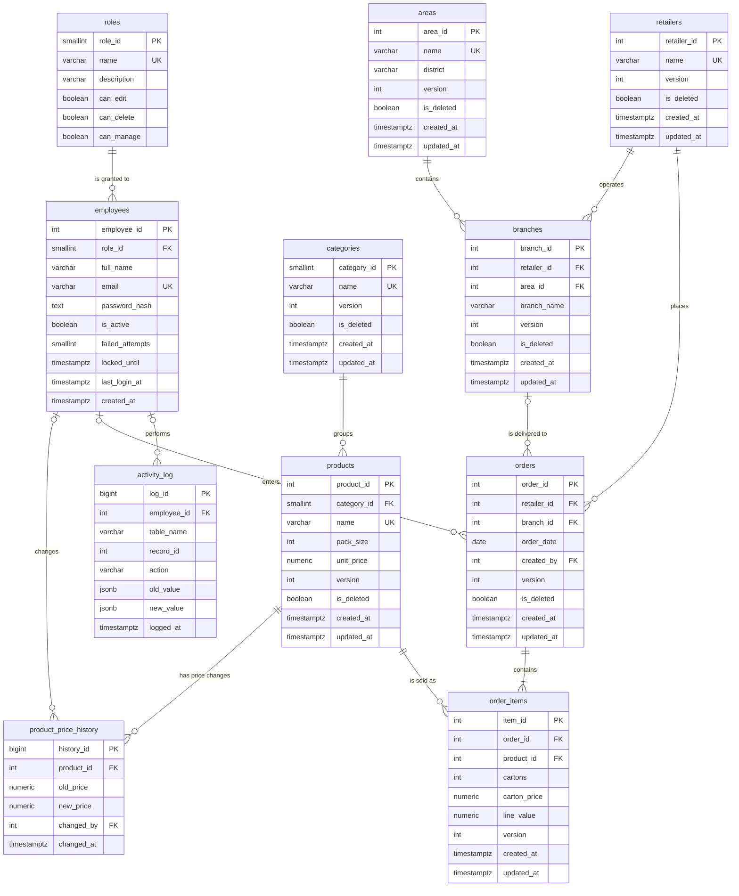

# Entity-Relationship Diagram (ERD)

**Project:** RouteLedger — Distribution Management System
**Companion documents:** [SRS](srs.md) · [SDS](sds.md) · [DFD](dfd.md) · [Database design](database.md)

This page is the standalone data model: the diagram, every relationship with its
cardinality and nullability, the reasoning behind the keys, and the normal form
of each table. The executable definition is
[`database/schema.sql`](../database/schema.sql).

> All rows in the repository and the public demo are synthetic, generated by
> [`database/generate_seed.py`](../database/generate_seed.py).

---

## 1. Diagram

`numeric` columns are `numeric(12,2)` for unit prices, `numeric(14,2)` for
carton prices and `numeric(16,2)` for line values. `activity_log.record_id` is a
logical reference (the changed table's key), not a foreign key, because it points
at eleven different tables.

## 2. Relationship catalogue

| # | Parent | Child | Cardinality | Foreign key | Optional? | On parent delete |
|---|---|---|---|---|---|---|
| 1 | `roles` | `employees` | 1 : 0..N | `employees.role_id` | No | Refused while employees exist |
| 2 | `categories` | `products` | 1 : 0..N | `products.category_id` | No | Refused while products exist |
| 3 | `products` | `product_price_history` | 1 : 0..N | `product_price_history.product_id` | No | Refused while history exists |
| 4 | `employees` | `product_price_history` | 1 : 0..N | `product_price_history.changed_by` | **Yes** | Refused while history exists; null for imports |
| 5 | `areas` | `branches` | 1 : 0..N | `branches.area_id` | No | Refused while branches exist |
| 6 | `retailers` | `branches` | 1 : 0..N | `branches.retailer_id` | No | Refused while branches exist |
| 7 | `retailers` | `orders` | 1 : 0..N | `orders.retailer_id` | No | Refused while orders exist |
| 8 | `branches` | `orders` | 1 : 0..N | `orders.branch_id` | **Yes** | Refused while orders exist |
| 9 | `employees` | `orders` | 1 : 0..N | `orders.created_by` | **Yes** | Refused while orders exist; null for imports |
| 10 | `orders` | `order_items` | 1 : 1..N | `order_items.order_id` | No | **Cascade** (used only by explicit maintenance) |
| 11 | `products` | `order_items` | 1 : 0..N | `order_items.product_id` | No | Refused while order lines exist |
| 12 | `employees` | `activity_log` | 1 : 0..N | `activity_log.employee_id` | **Yes** | Refused while log rows exist; null = system/import |

### Why these cardinalities

- **`roles` → `employees` (1:N, mandatory).** A role exists independently and
  may have no employees yet. Every employee must have exactly one role; the
  permission flags are read on every request, so a role cannot be null.
- **`categories` → `products` (1:N, mandatory).** A product without a category
  would break the dashboard's category mix, so the FK is `NOT NULL`. A category
  may temporarily have no products.
- **`retailers` → `branches` (1:N, mandatory) and `areas` → `branches` (1:N).**
  A branch is meaningful only as "this retailer's shop in this area". Both sides
  are required, and the pair is not unique: the same retailer may have two
  branches in one area.
- **`retailers` → `orders` (1:N, mandatory).** Every order belongs to one
  retailer. The Excel source named only the retailer, so the order header is the
  stable link; the branch is optional.
- **`branches` → `orders` (1:N, optional).** The original sheets did not record a
  branch for every order. When `branch_id` is present the API enforces that it
  belongs to `orders.retailer_id`; when absent the sale is attributed to the
  retailer only. This is why the relationship is drawn `|o--o{`.
- **`employees` → `orders` (1:N, optional).** `created_by` records who typed the
  order. Historic imports have no known author, so the column is nullable and the
  relationship is `|o--o{`.
- **`orders` → `order_items` (1:N, mandatory, at least one).** An order with no
  lines has no value and is rejected by `OrderCreate.items` (`min_length=1`) and
  by the API when deleting the last line. The diagram uses `||--|{`.
- **`products` → `order_items` (1:N, mandatory).** A line always names a real
  product. The price is copied onto the line, so the relationship does not carry
  the price.
- **`employees` → `activity_log` (1:N, optional).** Triggers may fire during a
  migration or seed where no employee context is set, so `employee_id` is
  nullable.

## 3. Key design

### 3.1 Surrogate primary keys

Every table uses a generated integer key (`serial`, `smallserial` or
`bigserial`). Reasons:

- Names change (a retailer rebrands, a product is renamed); keys must not.
- Integer keys keep the nine foreign-key indexes small.
- `order_items` and `activity_log` grow fastest, so they use `bigserial`.

### 3.2 Natural and composite unique keys

| Table | Unique key | Why |
|---|---|---|
| `roles` | `name` | Four fixed roles, referenced by name in the UI |
| `employees` | `email` | Login identifier; compared case-insensitively by the API |
| `categories` | `name` | Prevents "Beverages" and "beverages" duplicates |
| `products` | `name` | One catalogue entry per product name |
| `areas` | `name` | Areas are the geographic reporting unit |
| `retailers` | `name` | One account per retailer |
| `branches` | `(retailer_id, branch_name)` | "Main Branch" may exist for many retailers, but only once per retailer |
| `order_items` | `(order_id, product_id)` | Implements BR-1: one line per product per order |

The composite key on `branches` is the reason `branch_name` is **not** globally
unique. The composite key on `order_items` is what makes the order editor safe:
adding the same product twice fails in the database, not only in the UI.

### 3.3 Nullable foreign keys are deliberate

Only four FKs are nullable, and each represents a real business case:

| Column | Null means | Consequence |
|---|---|---|
| `orders.branch_id` | Branch was not recorded in the source sheet | Reports group the sale under "Not recorded" area |
| `orders.created_by` | Imported row with no known author | Audit still records later edits |
| `product_price_history.changed_by` | Price changed by a migration/seed | History remains complete |
| `activity_log.employee_id` | System or seed action | Log remains append-only and complete |

## 4. Normalisation

The source was a single flat Excel sheet with repeated product columns per order.
It was decomposed as follows.

### 4.1 First normal form (1NF)

- Every column holds one atomic value. The repeating product columns of the
  spreadsheet became rows in `order_items`.
- A multi-line order is one `orders` row plus N `order_items` rows.
- JSON is used only in `activity_log.old_value` / `new_value`, where the whole
  row snapshot is intentionally one value and is never queried by field.

### 4.2 Second normal form (2NF)

- In `order_items`, the key is `(order_id, product_id)`. `cartons`,
  `carton_price` and `line_value` depend on the whole key (this sale), so they
  stay.
- Product attributes (`name`, `pack_size`, `unit_price`, `category_id`) depend
  only on `product_id`, so they live in `products`, not on every line.
- In `branches`, `area_id` and `branch_name` depend on `branch_id`; nothing
  depends on only part of the composite unique key.

### 4.3 Third normal form (3NF)

- A branch's area is stored once as `branches.area_id`; the area name is not
  repeated on orders.
- A retailer's name is not repeated on orders or branches.
- A product's category is stored once as `products.category_id`.
- Role permission flags live in `roles`, not copied onto each employee, so
  changing a role's rights applies to all its employees at once.

### 4.4 Deliberate denormalisation

`order_items.line_value` duplicates `cartons × carton_price`.

- **Why:** a historical invoice must never change when the product's list price
  changes. Joining to the current price at read time would rewrite history.
- **How it is protected:** the API computes it server-side, a `CHECK` enforces
  `line_value >= 0`, and `carton_price` is the price **at the time of sale**.
- **Accepted cost:** one extra numeric column and the need to keep the
  calculation in one place (`orders.py`).

`order_items.carton_price` is similarly a point-in-time copy rather than a join
to `products.unit_price`. This is standard practice for sales documents.

## 5. Derived, historical and audit data

| Store | Type | Written by | Read by |
|---|---|---|---|
| `v_product_list` | View | — | Product list API |
| `v_branch_list` | View | — | Branch list API |
| `v_sales_detail` | View | — | Base for all sales reports |
| `v_sales_by_retailer` | View | — | Dashboard, retailer ranking |
| `v_sales_by_product` | View | — | Top products |
| `v_sales_by_month` | View | — | Monthly trend |
| `v_sales_by_area` | View | — | Area mix |
| `product_price_history` | Table | `fn_price_history` trigger | Price audit (SQL) |
| `activity_log` | Table | `fn_audit` trigger on 7 tables | Activity log API |

Views never store data, so they cannot drift. History and audit tables are
append-only: `product_price_history` has no update path, and `activity_log` has a
trigger plus revoked grants that refuse `UPDATE` and `DELETE`.

## 6. Integrity constraints by table

| Table | Constraint | Rule |
|---|---|---|
| `employees` | `chk_email_format` | Basic email shape (`x@y.z`) |
| `employees` | `CHECK (failed_attempts >= 0)` | Counter cannot go negative |
| `products` | `CHECK (pack_size > 0)` | A carton holds at least one unit |
| `products` | `CHECK (unit_price >= 0)` | No negative prices |
| `branches` | `UNIQUE (retailer_id, branch_name)` | Branch name unique within its retailer |
| `orders` | `CHECK (order_date >= DATE '2000-01-01')` | No ancient dates; the API also rejects future dates |
| `order_items` | `CHECK (cartons > 0)` | A line sells at least one carton |
| `order_items` | `CHECK (carton_price >= 0)` | No negative sale price |
| `order_items` | `CHECK (line_value >= 0)` | No negative line total |
| `order_items` | `UNIQUE (order_id, product_id)` | One line per product per order |
| `activity_log` | `CHECK (action IN ('INSERT','UPDATE','DELETE'))` | Closed action set |

## 7. Trigger map

| Trigger family | Tables | Effect |
|---|---|---|
| `trg_touch_*` (7) | `categories`, `products`, `areas`, `retailers`, `branches`, `orders`, `order_items` | Reject stale `version`, increment it, set `updated_at` |
| `trg_audit_*` (7) | same seven tables | Write `activity_log` with actor and before/after JSON |
| `trg_price_history` | `products` | Write old/new `unit_price` and actor on change |
| `trg_log_readonly` | `activity_log` | Raise on `UPDATE` or `DELETE` |

All trigger work happens inside the caller's transaction, so an audit row and the
change it describes commit or roll back together.

## 8. Index map

| Index | Column(s) | Serves |
|---|---|---|
| `idx_products_name_trgm` | `products.name` (GIN trigram) | `ILIKE '%text%'` product search |
| `idx_retailers_name_trgm` | `retailers.name` (GIN trigram) | Retailer search |
| `idx_products_category` | `products.category_id` | Category filter and join |
| `idx_branches_retailer` | `branches.retailer_id` | Retailer → branches |
| `idx_branches_area` | `branches.area_id` | Area filter and join |
| `idx_orders_date` | `orders.order_date` | Date range and monthly trend |
| `idx_orders_retailer` | `orders.retailer_id` | Retailer order list |
| `idx_items_order` | `order_items.order_id` | Order detail and totals |
| `idx_items_product` | `order_items.product_id` | Product sales |
| `idx_log_table_record` | `activity_log (table_name, record_id)` | "History of this record" |
| `idx_log_time` | `activity_log.logged_at` | Newest-first log view |

## 9. Extending the model

If stock control is added later, the natural extension is:

- `warehouses` (1:N) `stock_movements`, with `product_id` and a signed quantity.
- A `stock_on_hand` view that sums movements, rather than a mutable counter that
  can drift.
- `order_items.quantity_fulfilled` to keep the ordered and delivered quantities
  separate.

If multi-tenancy is added, every business table gains a `tenant_id` and
PostgreSQL row-level security policies filter on
`current_setting('app.tenant_id')`, matching the existing
`app.current_employee_id` pattern used by the audit triggers.

Any such change should preserve the current invariants: surrogate keys, an
explicit unique business key, `version` for optimistic locking, `is_deleted` for
soft delete, and audit triggers on every table that holds business data.
