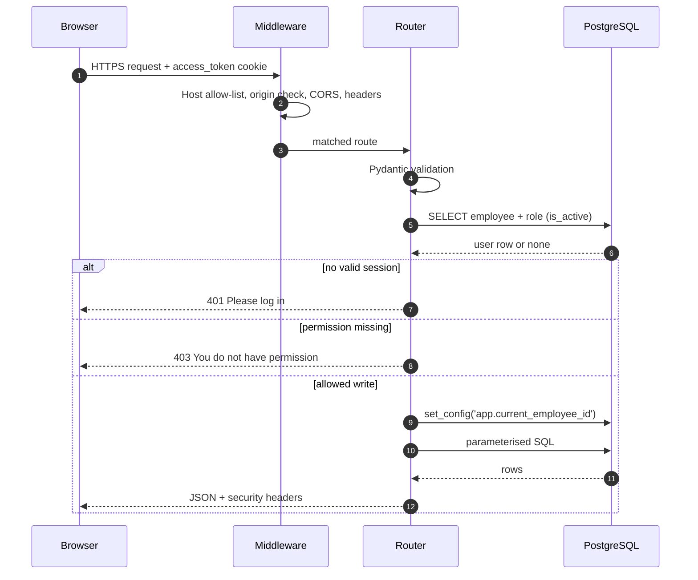
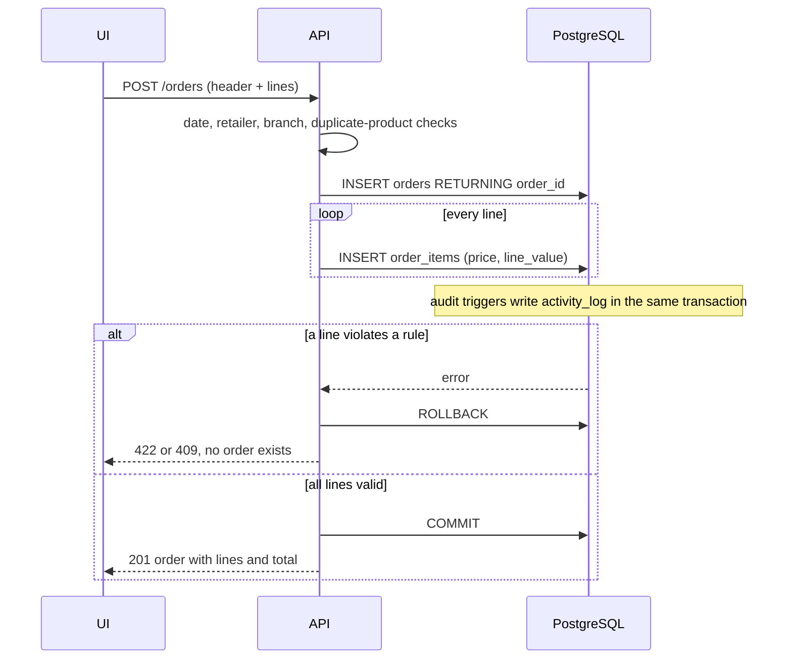

# Software Design Specification (SDS)

**Project:** RouteLedger — Distribution Management System
**Version:** 1.0
**Companion documents:** [SRS](srs.md) · [ERD](erd.md) · [DFD](dfd.md) · [Architecture](architecture.md) · [Database](database.md) · [Security](security.md) · [Deployment](deployment.md)

This document describes **how** RouteLedger is built: its components, the
request pipeline, the API contract, the data design, and the decisions behind
them. It maps every design element back to the requirements in the
[SRS](srs.md).

> All data in the repository and the public demo is synthetic. The seed is
> generated by [`database/generate_seed.py`](../database/generate_seed.py) with a
> fixed random seed.

---

## 1. Design goals

| Goal | Design response |
|---|---|
| One source of truth instead of emailed spreadsheets | Single PostgreSQL schema, server-side paging and search |
| Correct data even when the UI has a bug | Constraints, foreign keys, triggers and a least-privilege DB role |
| Nobody can silently overwrite a colleague | `version` column + trigger, surfaced as `409 Conflict` |
| Every change is attributable | Audit triggers write actor, timestamp and before/after JSON |
| Cheap to host and easy to read | One FastAPI process serves API and static pages; no frontend build |
| Runs unchanged locally, in Docker and on serverless | Environment-driven config, tiny `index.py` entrypoint |

## 2. System context

```
        ┌──────────────────────────────┐
        │  Browser (desktop / mobile)  │
        │  vanilla JS + CSS, no build  │
        └──────────────┬───────────────┘
                       │ HTTPS, fetch JSON, HttpOnly cookie
        ┌──────────────▼───────────────┐
        │  FastAPI application         │
        │  middleware → routers        │
        │  static file server          │
        └──────────────┬───────────────┘
                       │ psycopg 3 pool, bound parameters
        ┌──────────────▼───────────────┐
        │  PostgreSQL 16+ (Neon)       │
        │  11 tables, 7 views,         │
        │  16 triggers, 11 indexes     │
        └──────────────────────────────┘
```

There are three deployable shapes, all from the same source:

| Shape | Entrypoint | Database |
|---|---|---|
| Local development | `uvicorn app.main:app` in `backend/` | local PostgreSQL |
| Docker / Render | `docker/entrypoint.sh` → uvicorn | container or managed PostgreSQL |
| Vercel serverless | root `index.py` re-exports `app` | Neon (pooled endpoint) |

## 3. Architecture and request pipeline

FastAPI processes a request in this fixed order. The order matters: cheap
rejections happen before any database work.

1. **TLS termination** at the host (Vercel/Render/nginx).
2. **`TrustedHostMiddleware`** — unknown `Host` headers are rejected (DNS-rebinding defence).
3. **`check_request_origin`** — for `POST`, `PATCH`, `DELETE`, a foreign `Origin` or `Sec-Fetch-Site: cross-site` is answered with `403` before routing.
4. **`CORSMiddleware`** — only configured origins may make browser calls with credentials.
5. **Route match** — API routers first, then the `StaticFiles` mount at `/`.
6. **`get_db` dependency** — one pooled connection per request, wrapped in a transaction.
7. **`get_current_user`** — reads the JWT cookie, verifies the signature and expiry, then reloads employee and role from the database. A deactivated account fails here immediately.
8. **`require(permission)`** — for writes, checks `can_edit`, `can_delete` or `can_manage`, then calls `set_config('app.current_employee_id', …)` so database triggers can record the actor.
9. **Handler** — validates with Pydantic, executes parameterised SQL, returns JSON.
10. **`add_security_headers`** — adds CSP, `nosniff`, frame denial, COOP/CORP, `Referrer-Policy`, `Permissions-Policy`, `Cache-Control`, and HSTS when `COOKIE_SECURE=true`.
11. **Commit or rollback** — the `get_db` context commits on success and rolls back on any exception.



## 4. Component design

### 4.1 Backend modules

| Module | Responsibility | Key design point |
|---|---|---|
| `app/main.py` | App assembly, middleware registration, router inclusion, `/health`, static mount | Static mount is added last so API routes win |
| `app/config.py` | `pydantic-settings` model; reads `backend/.env` or environment | Validator refuses to start without a database configuration |
| `app/database.py` | psycopg `ConnectionPool`, `conninfo()`, `ensure_pool()`, `get_db()` | Pool opens lazily; `prepare_threshold=None` for poolers; `check_connection` recycles dead connections |
| `app/dependencies.py` | `get_current_user`, `require(permission)` | Permissions are re-read per request, so revocation is immediate |
| `app/middleware.py` | Security headers, CSRF origin check, in-process rate limiter | Pure ASGI-style functions, no external service |
| `app/security.py` | Argon2id hashing, JWT create/read, password strength | `DUMMY_HASH` equalises timing for unknown emails |
| `app/schemas.py` | Pydantic v2 request/response models | `Strict` strips surrounding whitespace; lengths and ranges match the DDL |
| `app/utils.py` | `like_pattern`, `page_response`, `friendly_db_errors`, `update_row`, `soft_delete`, `restore_row` | Table and column names come from code, never from request data |
| `app/routers/*.py` | One router per resource | Authorisation is a dependency, not an `if` inside the handler |

### 4.2 Frontend modules

| Module | Responsibility |
|---|---|
| `frontend/index.html` | Single entry page; loads `js/app.js` as a module |
| `js/app.js` | Shell, navigation, session bootstrap, theme and text-size controls |
| `js/api.js` | `fetch` wrapper, JSON error normalisation, redirect on `401` |
| `js/crud.js` | Reusable table, paging, form dialog and confirmation helpers |
| `js/ui.js` | DOM element builder, toasts, spinners, small chart primitives |
| `js/pages/login.js` | Login form, error display, optional demo hint and one-click fill |
| `js/pages/products.js`, `retailers.js`, `areas.js`, `orders.js`, `employees.js`, `activity.js`, `dashboard.js` | One module per screen |

Pages are built with DOM nodes (`el()`), never `innerHTML` with data. There is no
inline `<script>` and no third-party CDN, which is what allows the strict
`default-src 'self'` policy.

### 4.3 Database objects

| Object group | Count | Purpose |
|---|---|---|
| Tables | 11 | 3NF schema: roles, employees, categories, products, price history, areas, retailers, branches, orders, order items, activity log |
| Views | 7 | Product and branch lists plus five sales aggregates |
| Triggers | 16 | 7 optimistic-lock, 7 audit, 1 price history, 1 log immutability |
| Indexes | 11 | 2 GIN trigram search, 7 foreign-key/filter, 2 audit lookups |

Full definitions and the data dictionary are in
[`database.md`](database.md); the standalone diagram is in [`erd.md`](erd.md).

### 4.4 Operational scripts

| Script | Purpose |
|---|---|
| `scripts/bootstrap_db.py` | Applies schema and seed, creates the limited application role |
| `scripts/bootstrap_admin.py` | Creates the first admin from `ADMIN_EMAIL` / `ADMIN_PASSWORD` |
| `scripts/create_admin.py` | Interactive/local admin creation |
| `scripts/reset_password.py` | Offline password reset using the same Argon2 hasher |

## 5. Authentication and session design

**Login** (`POST /auth/login`)

1. Rate limiter allows 10 attempts per minute per client IP, returning `429` with `Retry-After`.
2. Employee is looked up case-insensitively and joined to its role.
3. Unknown or inactive account → verify against `DUMMY_HASH`, then `401` with the same message as a wrong password.
4. Locked account → `423` until `locked_until`.
5. Wrong password → increment `failed_attempts`; at 5 the account is locked for 15 minutes. The counter is committed before the error is raised, otherwise the rollback would erase it.
6. Correct password → reset counters, set `last_login_at`, sign a JWT (`sub`, `iat`, `exp`) with HS256.
7. Cookie `access_token`: `HttpOnly`, `SameSite=Lax`, `Path=/`, `Max-Age=TOKEN_MINUTES×60`, `Secure` when `COOKIE_SECURE=true`.

**Every later request** re-verifies the signature and expiry, then reloads the
employee and role. A deleted/deactivated employee is rejected even though the
cookie is still cryptographically valid. Logout deletes the cookie; rotating
`SECRET_KEY` invalidates every outstanding session.

**Demo hint** (`GET /auth/demo`) returns credentials only when both
`DEMO_EMAIL` and `DEMO_PASSWORD` are set. The endpoint never checks whether the
account is privileged, so the deployment guide requires a read-only Viewer for
this purpose. Unset the variables and the login page hides the box.

## 6. Data design summary

### 6.1 Tables and keys

| Table | Primary key | Natural/unique key | Main relationships |
|---|---|---|---|
| `roles` | `role_id` | `name` | 1 → many employees |
| `employees` | `employee_id` | `email` | → roles; referenced by orders and logs |
| `categories` | `category_id` | `name` | 1 → many products |
| `products` | `product_id` | `name` | → categories; → price history, order items |
| `product_price_history` | `history_id` | — | → products, employees |
| `areas` | `area_id` | `name` | 1 → many branches |
| `retailers` | `retailer_id` | `name` | → branches, orders |
| `branches` | `branch_id` | (`retailer_id`, `branch_name`) | → retailers, areas; optional in orders |
| `orders` | `order_id` | — | → retailers, optional branch, optional employee |
| `order_items` | `item_id` | (`order_id`, `product_id`) | → orders (cascade), products |
| `activity_log` | `log_id` | — | → employees (nullable) |

Every business table carries `version`, `is_deleted`, `created_at` and
`updated_at`. `activity_log` and `product_price_history` are append-only.

### 6.2 Reporting views

`v_product_list`, `v_branch_list`, and `v_sales_detail` (the base join) feed
`v_sales_by_retailer`, `v_sales_by_product`, `v_sales_by_month` and
`v_sales_by_area`. The dashboard reads these views instead of repeating joins in
Python, so every screen and the API reconcile to the same definition of a sale.

### 6.3 Derived and protected values

| Value | Stored? | How it is kept correct |
|---|---|---|
| `products` carton list price | No | Computed as `unit_price × pack_size` in `v_product_list` and in the API |
| `order_items.line_value` | Yes | Computed by the API as `cartons × carton_price`, protected by `CHECK (line_value >= 0)` |
| `version` | Yes | Incremented by `fn_touch_row`; a mismatched incoming version raises `40001` |
| `updated_at` | Yes | Set by `fn_touch_row` |
| Audit snapshots | Yes | `to_jsonb(OLD/NEW)` written by `fn_audit` in the same transaction |
| Price history | Yes | `fn_price_history` compares `OLD.unit_price` with `NEW.unit_price` |

## 7. API design

### 7.1 Conventions

- Base path is the site root; JSON only, except the static frontend.
- Authentication is the `access_token` cookie, never a bearer header.
- Errors use FastAPI's shape: `{"detail": "sentence"}` or `{"detail": [{...}]}` for field errors.
- Lists share one envelope: `{"items": [...], "total": n, "page": p, "page_size": s}`.
- `page_size` is capped at 100 in every list endpoint.
- Sort keys are `Literal` types mapped to an allow-list of SQL expressions.
- Writes that edit an existing row require the row's `version`.

### 7.2 Endpoints (44 in total)

Auth column: **Public** = no session; **Any** = any valid session;
**edit/delete/manage** = the corresponding role flag.

| Method | Path | Auth | Purpose |
|---|---|---|---|
| POST | `/auth/login` | Public (rate-limited) | Verify password, set session cookie |
| POST | `/auth/logout` | Any | Delete the session cookie |
| GET | `/auth/demo` | Public | Return the demo hint only when configured |
| GET | `/auth/me` | Any | Current employee, role and flags |
| GET | `/products` | Any | Paged list; `search`, `category_id`, `sort`, `order`, `page`, `page_size` |
| GET | `/products/categories` | Any | Category options |
| GET | `/products/{product_id}` | Any | Single product |
| POST | `/products` | edit | Create product |
| PATCH | `/products/{product_id}` | edit | Edit product; price change writes history |
| DELETE | `/products/{product_id}` | delete | Soft delete |
| POST | `/products/{product_id}/restore` | delete | Restore |
| GET | `/retailers` | Any | Paged list; `search`, `sort` (`name`/`branches`/`sales`) |
| GET | `/retailers/{retailer_id}` | Any | Single retailer |
| GET | `/branches` | Any | Paged list; `retailer_id`, `area_id`, `search` |
| POST | `/retailers` | edit | Create retailer |
| PATCH | `/retailers/{retailer_id}` | edit | Edit retailer |
| DELETE | `/retailers/{retailer_id}` | delete | Soft delete |
| POST | `/retailers/{retailer_id}/restore` | delete | Restore |
| POST | `/branches` | edit | Create branch |
| PATCH | `/branches/{branch_id}` | edit | Edit branch |
| DELETE | `/branches/{branch_id}` | delete | Soft delete |
| POST | `/branches/{branch_id}/restore` | delete | Restore |
| GET | `/areas` | Any | All areas |
| GET | `/areas/{area_id}` | Any | Single area |
| POST | `/areas` | edit | Create area |
| PATCH | `/areas/{area_id}` | edit | Edit area |
| DELETE | `/areas/{area_id}` | delete | Soft delete |
| POST | `/areas/{area_id}/restore` | delete | Restore |
| GET | `/orders` | Any | Paged list; `retailer_id`, `area_id`, `product_id`, `date_from`, `date_to`, `sort` (`date`/`retailer`/`total`/`cartons`) |
| GET | `/orders/{order_id}` | Any | Header plus all lines and total |
| POST | `/orders` | edit | Create header and **all** lines in one transaction |
| PATCH | `/orders/{order_id}` | edit | Edit header; changing retailer clears the branch |
| DELETE | `/orders/{order_id}` | delete | Soft delete |
| POST | `/orders/{order_id}/restore` | delete | Restore |
| POST | `/orders/{order_id}/items` | edit | Add one line |
| PATCH | `/orders/{order_id}/items/{item_id}` | edit | Change cartons/price, recompute `line_value` |
| DELETE | `/orders/{order_id}/items/{item_id}` | delete | Hard-delete a line, refused if it is the last one |
| GET | `/dashboard` | Any | Totals and breakdowns; optional `month=YYYY-MM` narrows the KPIs and breakdowns while the trend keeps every month |
| GET | `/employees` | manage | Employee list |
| GET | `/employees/roles` | manage | Role options |
| POST | `/employees` | manage | Create employee |
| PATCH | `/employees/{employee_id}` | manage | Change role/status or reset password |
| GET | `/activity-log` | delete | Paged audit log; `table_name`, `record_id`, `employee_id`, `action` |
| GET | `/health` | Public | `{"status": "ok", "products_in_database": n}` |
| GET | `/*` | Public | Static frontend (`index.html` for `/`) |

### 7.3 Status codes

| Code | Meaning in this API |
|---|---|
| `200` | Success |
| `201` | Created (product, retailer, branch, area, order, employee, order line) |
| `400` | Empty update, or deleting the last line of an order |
| `401` | No/expired session, or bad credentials |
| `403` | Permission missing, or cross-site write blocked |
| `404` | Record not found or already deleted |
| `409` | Duplicate value, or stale `version` |
| `422` | Validation failure, broken foreign key, bad date, branch/retailer mismatch |
| `423` | Account locked after repeated failures |
| `429` | Login rate limit exceeded; includes `Retry-After` |

`friendly_db_errors()` maps PostgreSQL exceptions to these codes:
`SerializationFailure → 409`, `UniqueViolation → 409`,
`ForeignKeyViolation → 422`, `CheckViolation`/`NotNullViolation → 422`.

## 8. Concurrency and transactions

### 8.1 Optimistic locking

```sql
IF NEW.version <> OLD.version THEN
    RAISE EXCEPTION 'Stale edit ...' USING ERRCODE = '40001';
END IF;
NEW.version := OLD.version + 1;
NEW.updated_at := now();
```

The client sends the version it displayed. If another user saved first, the
trigger raises serialization failure, `friendly_db_errors()` converts it to
`409`, and the UI tells the user to reload. Readers are never blocked.

### 8.2 Atomic order writes



`get_db()` yields one connection inside `with pool.connection()`, which commits
when the request returns and rolls back when an exception propagates. There is no
separate "save header" call that could leave an empty order behind.

### 8.3 Soft delete and restore

`DELETE` sets `is_deleted = TRUE`; every read filters it out. `restore` sets it
back. Order lines are the exception: deleting a line is a real `DELETE`, since
the line has no independent history, and the API refuses to remove the last line.

## 9. Security design

| Control | Where it lives | Why there |
|---|---|---|
| Password hashing | `security.py` (Argon2id) | Never store or log the plain value |
| Timing equalisation | `DUMMY_HASH` on unknown/inactive accounts | Prevent account enumeration |
| Lockout | `employees.failed_attempts`, `locked_until` | Persist across restarts |
| Rate limiting | `middleware.login_limiter` | Cheap, before any DB work |
| Session | Signed JWT in `HttpOnly`, `SameSite=Lax` cookie | JavaScript cannot read it; cross-site sends are limited |
| CSRF | `check_request_origin` | Reject foreign `Origin` / `Sec-Fetch-Site` |
| Authorisation | `require()` dependency on every write | UI hiding is never the only control |
| SQL injection | Bound parameters and literal sort maps | No user text reaches SQL structure |
| XSS | DOM construction, no inline script, strict CSP | Data never becomes HTML |
| Clickjacking | `X-Frame-Options: DENY`, `frame-ancestors 'none'` | Deny embedding |
| DNS rebinding | `TrustedHostMiddleware` | Reject unexpected `Host` values |
| Least privilege | `routeledger_app` role | No DDL, no audit rewrite |
| Secret handling | Environment variables, `.env` ignored | Nothing sensitive in Git |
| Transport | HTTPS + conditional HSTS | Protect cookie and data in transit |

The full threat model (STRIDE) and OWASP Top 10 mapping are in
[`security.md`](security.md).

## 10. Configuration and deployment design

Configuration is a single `Settings` object populated from environment variables
or `backend/.env`. The app refuses to start if neither `DATABASE_URL` nor
`DB_PASSWORD` is provided, and `SECRET_KEY` is mandatory.

| Variable | Default | Design notes |
|---|---|---|
| `DATABASE_URL` | – | Full URL; wins over the individual `DB_*` parts |
| `APP_DATABASE_URL` | – | Optional least-privilege override when the platform URL is owner-level |
| `DB_HOST`, `DB_PORT`, `DB_NAME`, `DB_USER`, `DB_PASSWORD` | localhost / 5432 / routeledger / postgres / – | Local and Docker path |
| `SECRET_KEY` | required | HS256 signing key; rotate to invalidate all sessions |
| `TOKEN_MINUTES` | 60 | Session lifetime |
| `COOKIE_SECURE` | false | Must be true over HTTPS |
| `CORS_ORIGINS` | localhost dev origins | Comma-separated; platform URLs are added automatically |
| `ALLOWED_HOSTS` | localhost, 127.0.0.1, testserver | `*.vercel.app` added automatically when `VERCEL` is set |
| `DEMO_EMAIL`, `DEMO_PASSWORD` | empty | Publish a read-only demo login; leave empty for real data |
| `DB_POOL_MIN`, `DB_POOL_MAX` | 1 / 5 | Serverless uses 0 / 2 |
| `DB_DISABLE_PREPARED` | false | True behind Neon/pgbouncer transaction pooling |

Two design choices make the same code portable:

- **`conninfo()`** chooses `APP_DATABASE_URL` → `DATABASE_URL` → assembled `DB_*` parts, in that order.
- **`ensure_pool()`** is idempotent and called both from the lifespan hook and from `index.py`, because serverless cold starts may skip lifespan startup.

Deployment steps for Vercel + Neon, Docker and Render are in
[`deployment.md`](deployment.md).

## 11. Performance design

| Concern | Design |
|---|---|
| Large lists | Server-side paging with `page_size ≤ 100`; `COUNT(*)` and page query share the same `WHERE` |
| Text search | `pg_trgm` GIN indexes on `products.name` and `retailers.name`; `%` and `_` escaped by `like_pattern` |
| Joins and filters | Indexes on every foreign-key column and `orders.order_date` |
| Dashboard | Seven views, six queries in one request, no per-row Python work |
| Connection cost | Pooled connections; `min_size=0` on serverless so idle functions hold nothing |
| Dead connections | `ConnectionPool.check_connection` before reuse |
| Caching | Private JSON is `no-store`; static assets are `no-cache` so updates appear |

## 12. Error handling and observability

- Handlers raise `HTTPException` with a short, user-safe sentence; stack traces never reach the client.
- Database exceptions are translated centrally in `friendly_db_errors()`.
- The frontend's `api.js` turns `detail` strings and field arrays into one readable message and redirects to the login page on `401`.
- `/health` is the only diagnostic endpoint and exposes just the product count, so it proves database connectivity without leaking schema details.
- There is no third-party telemetry. Platform logs (Vercel/Render) capture request errors.

## 13. Test design

| Layer | Approach |
|---|---|
| Security (`test_security.py`, 80 tests) | Real HTTP calls through `TestClient`; attack payloads for SQL injection and XSS; forged/expired/wrong-key tokens; role matrix for every write; CSRF and host headers; lockout and rate limit |
| Database (`test_database.py`, 18 tests) | Real PostgreSQL `routeledger_test`; constraint rejection; trigger behaviour; view reconciliation; rollback; audit immutability; least-privilege grants |
| CI | GitHub Actions runs both suites on Python 3.12 and 3.13 with a PostgreSQL service container, then builds the Docker image |

Tests run against a real database on purpose: the guarantees under test are
implemented in SQL, so mocking the database would test nothing.

## 14. Traceability to the SRS

| SRS requirement | Design element |
|---|---|
| FR-A1 … FR-A9 | `auth.py`, `security.py`, `dependencies.py`, login limiter |
| FR-A10 | `GET /auth/demo`, `DEMO_EMAIL`/`DEMO_PASSWORD`, `login.js` demo box |
| FR-P1 … FR-P6 | `products.py`, `v_product_list`, trigram indexes, `like_pattern` |
| FR-R1 … FR-R5 | `retailers.py`, `areas.py`, `uq_branch`, soft delete |
| FR-O1 … FR-O9 | `orders.py`, `order_items`, atomic transaction, carton pricing |
| FR-D1 … FR-D4 | `dashboard.py`, `v_sales_*` views |
| FR-E1 … FR-E5 | `employees.py`, `require("can_manage")` |
| FR-L1 … FR-L4 | `fn_audit`, `fn_log_readonly`, `activity_log.py`, grants |
| NFR-S1 … NFR-S8 | Middleware, CSP, host allow-list, bound SQL, DB role |
| NFR-P1 … NFR-P4 | Paging caps, GIN indexes, views, serverless pool settings |
| NFR-R1 … NFR-R4 | Transaction scope, `409` mapping, lazy pool, deployment backups |
| NFR-M1 … NFR-M4 | Pinned requirements, CI matrix, plain SQL files, env config |

## 15. Known limitations and extension points

| Limitation | Reason | Extension |
|---|---|---|
| Rate limiter is per process | Avoids an external dependency | Move to Redis when running more than one instance |
| No self-service password reset | Email delivery was out of scope | Add signed reset tokens plus an email provider |
| Single-tenant | Keeps the demo small | Add `tenant_id` and PostgreSQL row-level security |
| Dashboard aggregates are live | Dataset is small | Materialised views with scheduled refresh |
| Session revocation is global | JWT is stateless | Add a `token_version` per employee or a revocation table |
| Vercel deploys are manual | GitHub App installation needs a browser | Connect the repo in the Vercel dashboard for auto-deploy |
